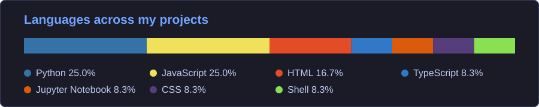

<div align="center">


<br/>


<a href="https://www.linkedin.com/in/ansh-chaudhary-cse"></a>
<a href="https://www.credly.com/users/ansh-chaudhary.7e8182e3"></a>

</div>

## About me

```python
class AnshChaudhary:
    role       = "Final Year B.Tech CSE @ MIET Meerut (AKTU)"
    focus      = ["Cloud", "DevOps", "Backend"]
    building   = "CloudOps Pulse — monitoring API + Docker + Terraform + CI/CD"
    learning   = ["Docker", "GitHub Actions", "Terraform", "Prometheus"]
    looking_for = "Cloud / DevOps internships (joining after 7th-sem exams)"
    location   = "Meerut, India"
```

I build small, real systems end to end — from a FastAPI service and its Docker image to the CI pipeline that tests it and the Terraform that puts it on AWS. My final-year group project, **StockFlow**, is also my first research paper, where I am first author.

## GitHub stats

<div align="center">


<br/>



</div>

## Skills

<div align="center">


</div>


| Area | What I work with |
|---|---|
| Cloud | AWS — S3, EC2, IAM, VPC basics, Auto Scaling / Load Balancing concepts, Secrets Manager |
| DevOps | Docker & docker-compose, GitHub Actions CI/CD, Terraform (AWS), Bash scripting |
| Backend | Python, FastAPI, REST APIs |
| Databases | MongoDB, PostgreSQL (via Supabase) |
| Foundations | Linux administration basics, Git & GitHub, networking fundamentals |

## Featured projects

| Project | What it is |
|---|---|
| [CloudOps Pulse](https://github.com/anshchaudhary289-prog/Cloudops-Pulse) | Production-style uptime/health monitoring API — FastAPI + Docker + GitHub Actions CI/CD + Prometheus metrics & alerts + Terraform for AWS EC2/S3 |
| [DairyTrack](https://github.com/anshchaudhary289-prog/DairyTrack) | Offline-first PWA for daily buffalo-milk sales records — morning/evening entries, per-customer rates, monthly accounts. **Live:** https://anshchaudhary289-prog.github.io/DairyTrack/ |
| [StockFlow](https://github.com/anshchaudhary289-prog/StockFlow) | AI-assisted invoice extraction & inventory automation for SME ERPs (GSTIN validation + risk scoring). Team Auto-Stack group project — I am first author of the research paper and lead the documentation, testing and ongoing development in my working copy |
| [FilterGuard](https://github.com/anshchaudhary289-prog/atomquest-filterguard) | Software-only predictive monitoring for water-purifier filter failure, built for Atomberg atomQUEST 2026 (Track 2) with Team Code&Design — gradient-boosting model estimates failure risk within the next seven days from synthetic TDS/flow/pressure trends |
| [TaskFlow Pro](https://github.com/anshchaudhary289-prog/taskflow-pro) | DAG-based, dependency-aware Kanban engine — tasks unblock automatically when their dependencies complete |
| [AWS S3 Portfolio](https://github.com/anshchaudhary289-prog/aws-s3-portfolio) · [EC2 Web Server](https://github.com/anshchaudhary289-prog/aws-ec2-webserver) | My first hands-on AWS builds — a portfolio site on S3 static hosting, and a Linux web server on EC2 with security groups & SSH |

## Certifications

- **AWS Academy Graduate – Cloud Architecting** (60 hours, with a hands-on capstone: RDS MySQL, Application Load Balancer, Auto Scaling, Secrets Manager) — verifiable on Credly
- **MongoDB** — 12 skill badges (Credly)
- **EY + Microsoft AI Skills Passport** — completed
- **Cisco Introduction to Cybersecurity**
- **NIIT Foundation CyberOps & Professional Edge**

## Contact

- LinkedIn: https://www.linkedin.com/in/ansh-chaudhary-cse
- GitHub: https://github.com/anshchaudhary289-prog

<div align="center">


</div>
